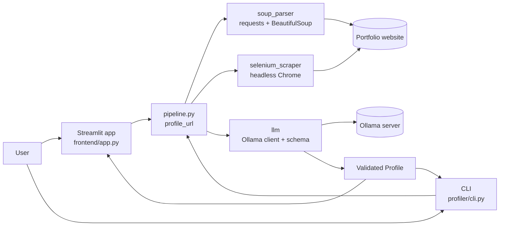

# Architecture

This document describes **how Portfolio Profiler is built**: the components, what each one is responsible for, and how they depend on each other. For a step-by-step walkthrough of what happens when you analyze a site, read [HOW_IT_WORKS.md](HOW_IT_WORKS.md).

## 1. What the system does

Input: the URL of a personal portfolio website.
Output: a structured `Profile` (name, headline, summary, skills, experience, education, projects, links) as JSON.

It does this by reading the site's pages, cleaning them into plain text, and asking an [Ollama](https://ollama.com) LLM to extract the profile, with strict rules against guessing.

## 2. High-level view



There are two entry points (web app and CLI) that share **one** core function, `profile_url()`. Everything else is a helper that the pipeline calls.

## 3. Project layout

```
frontend/
└── app.py                      Streamlit UI (calls the pipeline directly)

src/profiler/
├── cli.py                      Command-line entry point (`profiler` command)
├── pipeline.py                 Orchestrator: URL -> pages -> text -> LLM -> Profile
├── soup_parser/
│   ├── fetch.py                Plain HTTP download with requests
│   └── parse.py                HTML cleaning, link finding, JS-shell detection
├── selenium_scraper/
│   └── browser.py              BrowserSession: headless Chrome for JS-rendered sites
└── llm/
    ├── client.py               Ollama REST client, prompt, retry, reply parsing
    └── schema.py               Pydantic models (Profile, Experience, Education, Project)

tests/                          Offline tests using saved HTML fixtures and fakes
Makefile                        Shortcuts: setup, app, run, test, clean
pyproject.toml                  Dependencies and the `profiler` script entry point
```

## 4. Components

### 4.1 Entry points

| Component | File | Role |
|---|---|---|
| Web app | `frontend/app.py` | Sidebar settings (model, max pages), URL text area, live status per site, rendered profile, JSON download. |
| CLI | `src/profiler/cli.py` | Accepts one or more URLs, runs them one by one, prints a text summary and saves `output/<site>.json`. A failure on one site does not stop the batch. |

Both call `profile_url(url, model, max_pages, progress)`. The `progress` argument is just a callback that receives status strings: the CLI passes `print`, Streamlit passes `st.write`. This is how the same pipeline can drive two different UIs without knowing about either.

### 4.2 Pipeline (`pipeline.py`)

The orchestrator and the only module that knows about all the others.

- `normalize_url()` adds `https://` if it is missing.
- `collect_pages()` downloads the home page and a limited number of related pages, deciding between plain requests and a real browser.
- `merge_pages()` joins the page texts into one prompt and removes repeated lines.
- `profile_url()` runs the whole chain and returns a `ProfileResult` (`url`, `profile`, `pages`, `used_browser`).

### 4.3 `soup_parser`: fast path (no JavaScript)

- `fetch.py` → `fetch_html()` does a `requests.get` with a custom User-Agent and a 20 second timeout.
- `parse.py` contains three pure functions (no network, easy to test):
  - `clean_text(html)` removes `script`, `style`, `noscript`, `svg`, `iframe`, `nav` and `footer` tags, keeps the meta description, and returns one non-empty line per row.
  - `is_js_shell(text)` returns `True` if the cleaned text is shorter than 400 characters or contains "enable javascript". This is the switch that triggers the browser fallback.
  - `find_internal_links(html, base_url, limit)` returns same-site links worth visiting, most promising first (see §6).

### 4.4 `selenium_scraper`: fallback path (JavaScript sites)

`BrowserSession` wraps one headless Chrome instance.

- Created **lazily**, only when the fast path is not enough.
- **Reused** for every page of the same site, then closed in a `finally` block.
- `get_html(url)` loads the page, waits up to 15 seconds until the body has more than 200 characters of text, then scrolls to the bottom (up to 8 times) so lazy-loaded content appears, and returns `page_source`.
- Selenium 4.6+ downloads the matching `chromedriver` automatically.

### 4.5 `llm`: extraction and validation

- `schema.py` defines the **contract**: a Pydantic `Profile` in which every field is optional. Missing information stays `null` or an empty list; a validator turns `null` lists into `[]`.
- `client.py` talks to Ollama over its REST API (`POST /api/chat`):
  - Sends a system prompt with rules ("use ONLY information stated in the text", "if not mentioned, use null") and the JSON schema.
  - Passes the schema in Ollama's `format` field so the server tries to enforce it, and sets `temperature: 0` for repeatable output.
  - Truncates input to `MAX_CHARS = 30,000` characters.
  - Parses the reply tolerantly (strips markdown fences, extracts the outermost `{...}`), validates it with Pydantic, and **retries once** by feeding the error back to the model. After that it raises `LLMError`.
  - `list_models()` calls `GET /api/tags` so the UI can offer installed models.

## 5. Data flow and data shapes

```
str (URL)
  └─ normalize_url ──────────────► str (URL with scheme)
       └─ collect_pages ─────────► dict[str, str]   {page_url: clean_text}
            └─ merge_pages ──────► str              one prompt text, "=== PAGE: url ===" sections
                 └─ extract_profile ─► Profile      validated Pydantic object
                      └─ ProfileResult(url, profile, pages, used_browser)
                           ├─ Streamlit: rendered page + JSON download
                           └─ CLI: text summary + output/<site>.json
```

The only structured type that crosses module boundaries is `Profile`; everything before the LLM is plain strings and dicts.

## 6. Key design decisions

| Decision | Reason |
|---|---|
| **Fast path first, browser only when needed** | `requests` is quick and light. Starting Chrome for every site would be slow and wasteful. |
| **Empty-shell detection by text length** | Simple and effective heuristic: JS apps return almost no text before rendering. |
| **Synchronous, one page at a time, 1 s pause** | Easy to follow, polite to the target site, and Selenium is synchronous anyway. The slow part is the LLM, not downloads. |
| **One browser per site** | Avoids paying Chrome start-up cost for every sub-page. |
| **All schema fields optional** | The tool prefers "unknown" to a guess. |
| **Schema enforced twice** | Ollama's `format` field asks for valid JSON, and Pydantic verifies it afterwards, with one corrective retry. |
| **No API server** | Streamlit imports the pipeline directly. A server would add a layer without adding value at this size. |
| **Progress callback instead of logging framework** | Lets the same pipeline show live status in Streamlit and in a terminal. |

### Link selection (`find_internal_links`)

Candidate links must be `http(s)`, on the **same host** (ignoring `www.`), not already seen (ignoring `#fragments` and trailing `/`), and not a file such as `.pdf`, `.png`, `.zip`, `.docx`. Links whose path or anchor text contains words like `about`, `experience`, `work`, `project`, `resume`, `cv`, `portfolio`, `research`, `publication`, `education`, `skill` or `career` go **first**; the rest follow in page order. The list is then cut to the requested limit.

## 7. Configuration

| Setting | Where | Default | Purpose |
|---|---|---|---|
| `OLLAMA_URL` | env var | `http://localhost:11434` | Where the Ollama server is. |
| `OLLAMA_MODEL` | env var | `gpt-oss:20b-cloud` | Default model. |
| `--model` / sidebar selectbox | CLI / UI | `OLLAMA_MODEL` | Model for this run. |
| `--max-pages` / sidebar slider | CLI / UI | `5` (UI range 1–10) | Page budget per site. See [HOW_IT_WORKS.md §5](HOW_IT_WORKS.md#5-the-max-pages-per-site-option). |
| `--out` | CLI | `output` | Folder for JSON results. |

Hard-coded constants (change them in code): `PAUSE_SECONDS = 1` (pipeline), `MIN_TEXT_CHARS = 400` (parse), `MAX_CHARS = 30_000` and `TIMEOUT_SECONDS = 300` (llm client), `MIN_BODY_CHARS = 200` and `MAX_SCROLLS = 8` (browser).

## 8. Error handling

| Situation | Behaviour |
|---|---|
| Plain request fails (network error, HTTP error) | Falls back to the browser for the home page. |
| A sub-page fails to load | Logged as "Skipped …" and the run continues with the pages it has. |
| Browser render times out | Returns whatever has rendered so far. |
| Ollama unreachable or returns non-200 | `LLMError` with a readable message. |
| Model reply is not valid JSON/schema | One corrective retry, then `LLMError`. |
| Failure for one URL | CLI prints `FAILED` and continues; UI shows an error block for that URL only. |

## 9. Testing strategy

Tests run **offline**. HTML fixtures (`static_portfolio.html`, `js_shell.html`) replace real websites, and fakes replace Chrome and Ollama.

- `test_soup_parser.py`: cleaning, link selection and ordering, JS-shell detection.
- `test_llm_client.py`: reply parsing and the retry logic.
- `test_pipeline.py`: the static path and the browser path end to end.

## 10. Known limits

- Sites that block bots or require a login return little or nothing.
- `#/hash` routes look like a single URL, so sub-pages are not discovered (the home page is still read).
- Input to the model is capped at about 30,000 characters.
- Cloud models (`*-cloud`) send the scraped text to Ollama's servers. Use a local model for fully local processing.
- LLM output can be wrong; treat it as a summary and verify against the site.
