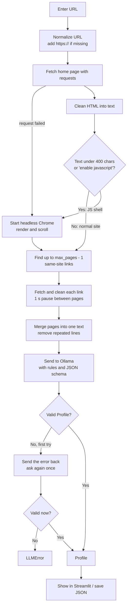

# How It Works

This document follows **one request from start to finish**: what happens between pasting a URL and getting a profile back. For the structure of the code and design decisions, read [ARCHITECTURE.md](ARCHITECTURE.md).

## 1. The idea in one paragraph

A portfolio website is written for humans, not programs. Portfolio Profiler downloads the site, strips away everything that is not readable content, gives that text to a language model, and asks it to fill in a fixed form (name, skills, experience, projects, ...). The model is told to use only what the site says and to answer `null` for anything missing. The answer is then checked against a schema before you see it.

## 2. End-to-end flow



## 3. Step by step

### Step 1: Normalize the URL

`example.com` becomes `https://example.com`. Nothing is guessed beyond adding the scheme.

### Step 2: Fetch the home page

The home page is downloaded with plain `requests` (20 second timeout, a descriptive User-Agent). This is the **fast path** and it works for any site whose content is already in the HTML.

### Step 3: Clean the HTML

BeautifulSoup removes tags that never hold profile information: `script`, `style`, `noscript`, `svg`, `iframe`, `nav` and `footer`. It keeps the page's meta description (often a good one-line bio) and returns the visible text with one non-empty line per row.

### Step 4: Decide whether a browser is needed

Many portfolios (React, Next.js, ...) send an almost empty HTML file and build the page with JavaScript. `requests` cannot run JavaScript, so the cleaned text would be nearly blank.

The check is simple: **the page is treated as a JS shell if its cleaned text is under 400 characters or contains "enable javascript".** If the plain request itself failed, the tool also tries the browser.

When a browser is needed, one headless Chrome is started. It loads the page, waits (up to 15 seconds) until the body has real text, then scrolls to the bottom (up to 8 times) so lazy-loaded sections appear. That Chrome is **reused for every further page of the same site** and closed at the end.

### Step 5: Find more pages worth reading

A portfolio is rarely one page. The tool looks at the links on the home page and keeps only:

- links to the **same site** (`www.` is ignored),
- links not already seen (fragments like `#top` and trailing slashes are ignored),
- links that are **not** files (`.pdf`, `.png`, `.jpg`, `.zip`, `.docx`, ...), `mailto:`, `tel:` or `javascript:`.

They are ranked so that links containing words like *about, experience, work, project, resume, cv, portfolio, research, publication, education, skill, career* (in the URL or the link text) come **first**. Then the list is cut to the page budget (see §5).

Each chosen page is fetched (through Chrome if the browser is in use, otherwise `requests`), cleaned the same way, and **1 second is waited between pages** to be polite. If a page fails, it is skipped and the run continues.

### Step 6: Merge into one prompt

The page texts are joined into one document, each under a heading such as `=== PAGE: https://example.com/about ===`. Long lines (20+ characters) that already appeared on an earlier page, such as repeated menus, taglines or footers, are dropped so they do not waste space. Short lines are kept, because things like "Python" or "2021" are meaningful even when repeated.

### Step 7: Ask the model

The text goes to Ollama (`POST /api/chat`) with:

- a **system prompt** with the rules: use only what the text says, never invent, use `null` for anything not mentioned, reply with one JSON object and nothing else;
- the **JSON schema** of `Profile`, included both in the prompt and in Ollama's `format` field so the server tries to enforce it;
- `temperature: 0`, so the same page gives (as far as possible) the same answer.

If the merged text is longer than **30,000 characters**, it is cut and marked `[text truncated]`. Because pages are merged in priority order, the least important pages are the ones cut first.

### Step 8: Validate the answer

The reply is parsed forgivingly (markdown fences and stray text around the `{...}` are ignored) and checked against the Pydantic `Profile` schema. If it is invalid, the model is shown its own reply plus the error and asked **once** to correct it. If the second attempt is also invalid, the tool stops with a clear `LLMError` instead of showing bad data.

### Step 9: Show or save the result

- **Web app:** the profile is rendered as sections (summary, skills, experience, education, projects, links), with the raw JSON, the list of pages read and a **Download JSON** button. The caption tells you how many pages were read and whether the browser was used.
- **CLI:** a short text summary is printed and the full JSON is saved to `output/<site>.json`.

## 4. The output

```json
{
  "name": "Jane Doe",
  "headline": "Machine Learning Engineer",
  "location": null,
  "email": null,
  "summary": "Two or three sentences about who she is and what she does.",
  "skills": ["Python", "PyTorch"],
  "experience": [
    { "company": "Acme", "title": "ML Engineer", "start": "2021", "end": null, "description": "..." }
  ],
  "education": [
    { "institution": "Some University", "degree": "MSc", "years": "2018-2020" }
  ],
  "projects": [
    { "name": "Project X", "description": "...", "url": "https://..." }
  ],
  "links": ["https://github.com/janedoe"]
}
```

Fields the site does not mention stay `null` (or `[]` for lists). That is intentional: **"unknown" is a valid answer; a made-up value is not.**

## 5. The "Max pages per site" option

**What it is:** the maximum number of pages the tool reads for **each** website, **including the home page**. It appears as the **"Max pages per site"** slider in the web app (range 1 to 10, default 5) and as `--max-pages` in the CLI (default 5).

**How it is applied:** the home page is always read. The tool then follows up to `max_pages - 1` additional same-site links, chosen in priority order (§3, step 5).

| Value | What is read |
|---|---|
| `1` | Home page only. Fastest; good for one-page portfolios. |
| `3` | Home page + the 2 most promising links (usually About and Projects). |
| `5` (default) | Home page + up to 4 links. A balanced default for typical portfolios. |
| `10` | Home page + up to 9 links. Most complete, slowest. |

**What it is for:**

- **Coverage.** A home page is often only a landing page. The details (job history, projects, education) usually live on sub-pages. A higher value finds more of them.
- **Speed.** Every extra page costs a download (plus a 1 second pause) and adds text for the model to read. A lower value gives faster runs.
- **Politeness.** It limits how many requests are sent to someone else's website. Keep it low when you do not need more.
- **Model limits.** All pages are merged into one prompt capped at about 30,000 characters. Reading more pages than that can hold gives no benefit, because the extra text is cut off.

**Choosing a value:**

- One-page or simple sites: `1` to `3`.
- Typical portfolios with About / Projects / Experience pages: `5`.
- Large sites with many sections, when you need every detail: `7` to `10`.

**Good to know:**

- The value is a **maximum**, not a target. If a site has fewer suitable links, fewer pages are read. The result shows the real number ("Pages read: N").
- It applies **per site**, so with several URLs each gets its own budget.
- The slider stops at 10, but the CLI does not enforce an upper limit. Use it responsibly.
- It cannot help with `#/hash` routes, where sub-pages share one URL and are never discovered.

## 6. Running it

```bash
uv sync                                   # install dependencies
ollama signin && ollama pull gpt-oss:20b-cloud   # default (cloud) model
                                          # or: ollama pull llama3.1:8b  for a fully local model

make app                                  # web app
make run URL=https://example.com          # CLI, one site
uv run profiler a.com b.com --model llama3.1:8b --max-pages 3
```

Environment variables (optional): `OLLAMA_URL` (default `http://localhost:11434`) and `OLLAMA_MODEL` (default `gpt-oss:20b-cloud`).

## 7. Troubleshooting

| Symptom | Likely cause | What to do |
|---|---|---|
| "Could not reach Ollama" | Ollama is not running, or `OLLAMA_URL` is wrong. | Start Ollama; check the URL. |
| Empty or very thin profile | Site blocks bots, needs a login, or uses `#/hash` routes. | Try another page URL of the site directly. |
| Missing details you can see on the site | Content is on pages that were not read. | Raise **Max pages per site**. |
| Details cut off on very long sites | 30,000 character cap reached. | Lower the page count, or start from a more focused URL. |
| Chrome errors | Chrome not installed or not up to date. | Install/update Google Chrome. |
| "The model did not return valid JSON" | The model cannot follow the schema. | Try a larger or different model. |
| Model info seems wrong | LLMs can misread text. | Check the output against the site. |

## 8. Use it responsibly

Use the tool on public portfolio pages. Check a site's terms and `robots.txt`, keep the page limit low, and remember that the pages describe real people. With `*-cloud` models the scraped text is sent to Ollama's servers; use a local model if that is a concern.
